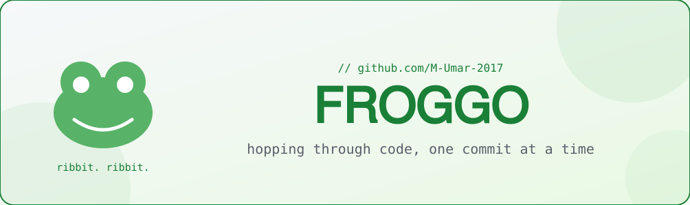

<!-- hero banner -->
<picture>
  <source media="(prefers-color-scheme: dark)" srcset="assets/banner-dark.svg">
  
</picture>

<picture>
  <source media="(prefers-color-scheme: dark)" srcset="https://readme-typing-svg.deno.dev?font=Fira+Code&size=22&pause=1200&color=3FB950&center=true&vCenter=true&width=620&lines=%F0%9D%96%A5%F0%9D%96%B6%F0%9D%96%BA+%F0%9D%96%A8%F0%9D%96%BA%F0%9D%96%BA+%F0%9D%96%85%F0%9D%96%BA%F0%9D%96%BC%F0%9D%96%B6%F0%9D%96%86%F0%9D%96%A7%F0%9D%96%BA%F0%9D%96%BA+%F0%9D%96%A5%F0%9D%96%BA%F0%9D%96%BA%F0%9D%96%AF%F0%9D%96%86%F0%9D%96%BE%F0%9D%96%BA+%F0%9D%96%BC%F0%9D%96%BE%F0%9D%96%A2%F0%9D%96%B1%F0%9D%96%BE%F0%9D%96%A1%F0%9D%96%86%F0%9D%96%AF%F0%9D%96%BA%F0%9D%96%AF%F0%9D%96%BA%F0%9D%96%AF+%F0%9D%96%99%F0%9D%96%9A%F0%9D%96%96%F0%9D%96%AF%F0%9D%96%BC%F0%9D%96%BA%F0%9D%96%A1%F0%9D%96%86%F0%9D%96%9D%F0%9D%96%99%F0%9D%96%97%F0%9D%96%86%F0%9D%96%A1%F0%9D%96%97%F0%9D%96%86%F0%9D%96%AE%F0%9D%96%91%F0%9D%96%A2%F0%9D%96%96%F0%9D%96%AF%F0%9D%96%99%F0%9D%96%9D%F0%9D%96%9A%F0%9D%96%99%F0%9D%96%96%F0%9D%96%97%F0%9D%96%86%F0%9D%96%9B%F0%9D%96%99%F0%9D%96%9A%F0%9D%96%A5%F0%9D%96%9C%F0%9D%96%9F%F0%9D%96%96%F0%9D%96%99%F0%9D%96%9C%F0%9D%96%96%F0%9D%96%A2%F0%9D%96%99%F0%9D%96%A6%F0%9D%96%91%F0%9D%96%91%F0%9D%96%86%F0%9D%96%99%F0%9D%96%A1%F0%9D%96%96%F0%9D%96%9F%F0%9D%96%96%F0%9D%96%A5%F0%9D%96%96%F0%9D%96%99%F0%9D%96%A5%F0%9D%96%99%F0%9D%96%A8%F0%9D%96%97%F0%9D%96%96%F0%9D%96%9F%F0%9D%96%96%F0%9D%96%9F%F0%9D%96%96%F0%9D%96%9F%F0%9D%96%96%F0%9D%96%9F%F0%9D%96%96%F0%9D%96%9F%F0%9D%96%9C">
  
</picture>

---

## About the frog

I make small tools with big personalities — custom text editors, portable app launchers, anime-flavoured CLIs, and terminal ricing. Off-screen I am learning 3D in Blender and making Discord emotes.

- Currently hacking on **[ViB](https://github.com/M-Umar-2017/ViB)** — a Vim-flavoured build/CI playground
- Best known for **[FROGGO-Link-Portfolio](https://github.com/M-Umar-2017/FROGGO-Link-Portfolio)** and portable app releases
- Weakness: dark themes and everything green

---

## Toolbox

&nbsp;
&nbsp;
&nbsp;
&nbsp;
&nbsp;

&nbsp;
&nbsp;
&nbsp;
&nbsp;
&nbsp;

---

## Projects worth a hop

<picture>
  <source media="(prefers-color-scheme: dark)" srcset="https://github-readme-stats.vercel.app/api/pin/?username=M-Umar-2017&repo=ViB&hide_border=true&bg_color=0d1117&title_color=3fb950&icon_color=3fb950&text_color=c9d1d9">
  
</picture>
&nbsp;
<picture>
  <source media="(prefers-color-scheme: dark)" srcset="https://github-readme-stats.vercel.app/api/pin/?username=M-Umar-2017&repo=FROGGO-Link-Portfolio&hide_border=true&bg_color=0d1117&title_color=3fb950&icon_color=3fb950&text_color=c9d1d9">
  
</picture>

---

## Swamp stats

<picture>
  <source media="(prefers-color-scheme: dark)" srcset="https://github-readme-stats.vercel.app/api?username=M-Umar-2017&show_icons=true&hide_border=true&bg_color=0d1117&title_color=3fb950&icon_color=3fb950&text_color=c9d1d9">
  
</picture>
&nbsp;
<picture>
  <source media="(prefers-color-scheme: dark)" srcset="https://streak-stats.deno.app/?user=M-Umar-2017&hide_border=true&background=0D1117&ring=3FB950&fire=3FB950&currStreakLabel=3FB950&currStreakNum=C9D1D9&sideLabels=8B949E&sideNums=C9D1D9&dates=8B949E">
  
</picture>

<picture>
  <source media="(prefers-color-scheme: dark)" srcset="https://github-readme-stats.vercel.app/api/top-langs/?username=M-Umar-2017&layout=compact&hide_border=true&bg_color=0d1117&title_color=3fb950&text_color=c9d1d9">
  
</picture>

---

## The snake in my swamp

<picture>
  <source media="(prefers-color-scheme: dark)" srcset="assets/snake-dark.svg">
  
</picture>

---

## Trophies

<picture>
  <source media="(prefers-color-scheme: dark)" srcset="https://github-profile-trophy.vercel.app/?username=M-Umar-2017&theme=chartreuse-dark&no-frame=true&no-bg=true&column=7">
  
</picture>

---

designed by 𝖥𝖱𝖮𝖦𝖦𝖮 — hop your own path

