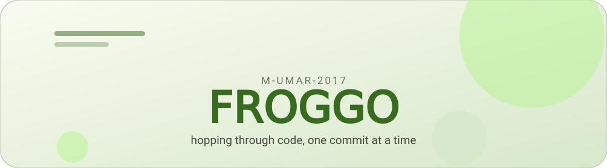
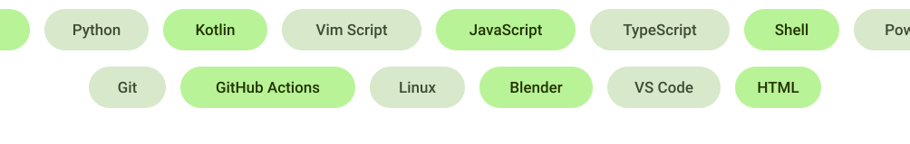

<!-- material you hero -->
<picture>
  <source media="(prefers-color-scheme: dark)" srcset="assets/m3-hero-dark.svg">
  
</picture>

# 𝖥𝖱𝖮𝖦𝖦𝖮

<picture>
  <source media="(prefers-color-scheme: dark)" srcset="https://readme-typing-svg.deno.dev?font=Fira+Code&size=20&pause=1200&color=A6D34F&center=true&vCenter=true&width=560&lines=C%2B%2B+tinkerer+%C2%B7+Python+summoner;small+tools%2C+big+personalities">
  
</picture>

---

<picture>
  <source media="(prefers-color-scheme: dark)" srcset="assets/m3-chip-about-dark.svg">
  
</picture>

I build small tools with big personalities — custom text editors, portable app launchers, anime-flavoured CLIs and terminal rices. Off-screen I am learning 3D in Blender and making Discord emotes.

---

<picture>
  <source media="(prefers-color-scheme: dark)" srcset="assets/m3-chip-langs-dark.svg">
  
</picture>

<picture>
  <source media="(prefers-color-scheme: dark)" srcset="assets/m3-langs-dark.svg">
  
</picture>

---

<picture>
  <source media="(prefers-color-scheme: dark)" srcset="assets/m3-chip-stats-dark.svg">
  
</picture>

<picture>
  <source media="(prefers-color-scheme: dark)" srcset="https://github-readme-stats.vercel.app/api?username=M-Umar-2017&show_icons=true&hide_border=true&bg_color=12150E&title_color=A6D34F&icon_color=A6D34F&text_color=C9D1C4&ring_color=2E4A18">
  
</picture>
&nbsp;
<picture>
  <source media="(prefers-color-scheme: dark)" srcset="https://github-readme-stats.vercel.app/api/top-langs/?username=M-Umar-2017&layout=compact&hide_border=true&bg_color=12150E&title_color=A6D34F&text_color=C9D1C4">
  
</picture>

